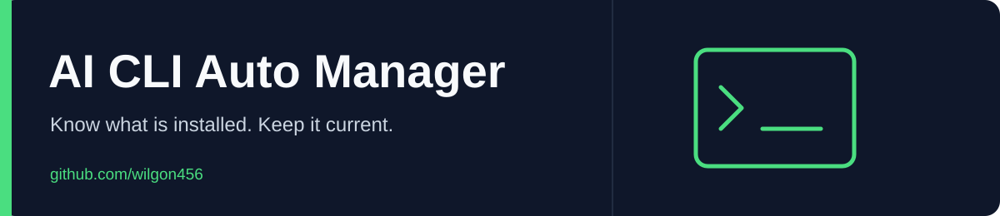

<div align="center">



# AI CLI Auto Manager

AI 코딩 CLI 목록을 점검하고, 보수적으로 업데이트하고, 예약 정리를 관리합니다.

[English](README.md) · **한국어**

  [](LICENSE)

[빠른 시작](#빠른-시작) · [명령](#명령) · [예약 실행](#예약-실행)

[](https://github.com/wilgon456/ai_cli_auto_manager/actions/workflows/ci.yml)

</div>

---

AI 코딩 CLI를 몇 달 쓰면 세 가지가 헷갈리기 시작합니다. 무엇을 깔아 두었는지, 그게 최신인지, 디스크를 얼마나 먹는지입니다.
같은 CLI가 앱용·npm용으로 두 벌 깔려 있어서 업데이트는 한쪽만 되고 실제로는 옛 버전을 쓰고 있는 일도 흔합니다.
이 도구는 세 가지 일을 예약해 두고 대신 챙깁니다. 설치 없이 저장소를 받아 명령 하나로 예약하면 됩니다.

| 작업 | 주기 (기본 시각) | 하는 일 |
| --- | --- | --- |
| 목록 | 매주 (월 12:00) | 깔린 AI CLI를 찾아 버전, 최신 버전, 설치 방식, 매일 업데이트가 실제로 닿는지를 표로 남깁니다. CLI끼리 MCP 서버와 스킬이 어긋났는지도 봅니다. 새로 생기거나 사라진 CLI는 알림으로 알려 줍니다 |
| 업데이트 | 매일 (05:00) | 깔린 CLI를 모두 올립니다. npm으로 깐 CLI는 나온 지 3일 지난 버전만, 이상 징후와 서명을 확인한 뒤 깝니다. 하나가 실패해도 나머지는 계속합니다. 세션이 끝난 뒤에도 남아 도는 MCP 서버·브라우저·에이전트 CLI를 알려 줍니다 |
| 정리 | 매주 (월 12:30) | 30일 동안 쓰지 않은 대화 기록과 날짜가 지난 임시 파일·캐시를 지우고, 작업이 이미 합쳐진 git worktree와 가지를 정리합니다. 링크는 따라가지 않고, 메모리·인증·설정 파일과 올리지 않은 작업은 건드리지 않습니다 |

세 작업은 실행될 때마다 나머지 둘이 아직 등록돼 있는지 확인합니다. 예약이 사라졌거나 실행이 실패하면 바탕화면 알림을 띄웁니다.

## 빠른 시작

정리 작업은 30일 동안 쓰지 않은 대화 기록을 영구 삭제할 수 있습니다. 규칙을
미리 확인하고 보관할 기록은 백업해 두세요. 아래 예시는 업데이트와 목록 예약만
등록합니다. 지원하는 설치 방식과 정리 예약을 켜는 절차는
[호환성·첫 실행 안내](docs/compatibility.md)에 있습니다.

### Windows

```powershell
git clone https://github.com/wilgon456/ai_cli_auto_manager.git
cd ai_cli_auto_manager
Set-ExecutionPolicy -Scope CurrentUser RemoteSigned

.\bin\aicm.ps1 inventory           # 깔린 AI CLI와 업데이트 지원 여부 확인
.\bin\aicm.ps1 status              # 예약 상태, 마지막 실행, 폴더별 용량과 지울 수 있는 양
.\bin\aicm.ps1 clean -DryRun       # 지울 대상만 미리 보기
.\bin\aicm.ps1 schedule install -NoClean  # 매일 05:00 업데이트, 매주 월요일 12:00 목록
```

### macOS · Linux

```bash
git clone https://github.com/wilgon456/ai_cli_auto_manager.git
cd ai_cli_auto_manager

./bin/aicm inventory
./bin/aicm status
./bin/aicm clean --dry-run
./bin/aicm schedule install --no-clean
```

## 명령

| 명령 | 하는 일 |
| --- | --- |
| `aicm inventory` | 깔린 AI CLI 목록을 만듭니다. `--offline`(`-Offline`)이면 최신 버전 조회를 건너뜁니다 |
| `aicm update` | 깔린 AI CLI를 올립니다. `--dry-run`, `--targets codex,claude`, `--install-missing`, `--min-release-age-days N` |
| `aicm clean` | 오래된 찌꺼기를 지웁니다. `--dry-run`, `--rules id,id`, `--category sessions,cache,logs,temp,other` 또는 `all`, `--json`, `--explain` |
| `aicm archive list` | 일반 아카이브 목록(최신순). `--json`, `--limit N`, `--offset N`. 예전 파일은 수동 복원 |
| `aicm archive gc` | 다시는 복원할 수 없는 색인 기록(보관 폴더가 이미 정리됨, 복원 후 30일 지남)을 지웁니다. `--dry-run`, `--json` |
| `aicm restore ID` | 색인된 파일 하나를 되돌립니다. `--dry-run`, `--json`. 원래 경로가 있으면 덮어쓰지 않습니다 |
| `aicm history` | 로컬 업데이트·정리·복원 기록(최대 100건, 파일 내용은 저장하지 않음). `--limit N`, `--json` |
| `aicm worktrees` | 세션들이 남긴 worktree와 가지. `--apply`(`-Apply`)를 줘야만 지웁니다. `--days 14` |
| `aicm config` | 깔린 CLI끼리 MCP 서버와 스킬 비교 |
| `aicm processes` | 세션이 끝난 뒤에도 남아 도는 에이전트 프로세스. `--kill`(`-Kill`)이면 끕니다 |
| `aicm optimize` | 패키지 관리자 자체 명령(`npm cache verify`, `uv cache prune`, `pnpm store prune`)으로 캐시를 손봅니다. 기본은 미리보기이고 `--apply`(`-Apply`)를 줘야만 실행합니다. `--tasks npm-verify,uv-prune,pnpm-prune`, `--dry-run`, `--json`. Node.js가 필요합니다 |
| `aicm status` | 예약 상태, 마지막 실행 결과, 마지막 목록, 규칙별 용량과 지울 수 있는 양을 보여 줍니다 |
| `aicm doctor` | 예약이 사라졌거나 실행이 밀렸거나 실패했을 때, 업데이트 정책이 잘못되었거나(또는 필요한 Node.js가 없을 때), `AICM_HOME`을 쓸 수 없을 때 문제를 적고 종료 코드 1을 냅니다. 설치 사본과 그 원본·버전도 보여 줍니다. 아무것도 바꾸지 않습니다 |
| `aicm schedule install` | 업데이트·목록·정리 예약을 등록합니다. 다시 실행하면 같은 작업을 덮어씁니다 |
| `aicm schedule remove` | 등록한 예약을 지웁니다 |
| `aicm uninstall` | 예약과 설치 사본을 지웁니다. `--purge`(`-Purge`)면 이 도구가 쓴 로그·상태·아카이브까지 지웁니다. `--dry-run`(`-DryRun`)은 지울 것만 보여 주고 아무것도 바꾸지 않습니다 |
| `aicm version` | 버전을 출력합니다 |

Windows에서는 `.\bin\aicm.ps1 <명령>`을 쓰고, 옵션은 `-DryRun`, `-Targets`, `-Rules`처럼 PowerShell 방식으로 줍니다.

## 목록

어떤 CLI를 찾을지는 [`rules/ai-clis.conf`](rules/ai-clis.conf) 카탈로그에 있습니다. Claude Code, Codex, OpenCode, Grok Build, Kimi Code, Antigravity, Gemini CLI, Qwen Code, GitHub Copilot CLI, Amp, Augment Auggie, Crush, Continue, Cursor Agent, Goose, Factory Droid, Aider, OpenCode Desktop(Windows)이 들어 있습니다.

```text
CLI                  via         version        latest         state     daily update
Claude Code          npm         2.1.288        2.1.291        held      yes
OpenAI Codex         standalone  0.157.1        0.160.1        behind    no: update the PATH copy with its owning app or installer
                     npm copy 0.160.1 is also installed, but PATH runs C:\...\OpenAI\Codex\bin\codex.exe
Grok Build           standalone  1.0.46         1.0.46         current   yes
Cursor Agent         standalone  2026.09.18                    installed yes
```

`state`가 `held`이면 더 새 버전이 나왔지만 아직 3일 대기 중이라는 뜻입니다. `daily update` 칸이 `no`이면 매일 업데이트가 그 CLI에 닿지 않는다는 뜻이고, 이유를 함께 적습니다. 위 Codex처럼 자동 업데이트를 지원하지 않는 사본이 PATH에서 npm 설치보다 먼저 선택되면, 선택된 경로를 보여 주고 처음 발견할 때 해결 방법을 알립니다. 업데이트는 PATH가 선택한 설치를 기준으로 진행합니다.
결과는 `~/.ai-cli-auto-manager/inventory.md`(사람이 읽는 표)와 `state/inventory.json`에 남습니다. 카탈로그에 없는 전역 npm 패키지는 표 아래에 따로 적습니다.

카탈로그에 CLI를 더하려면 `~/.ai-cli-auto-manager/ai-clis.local.conf`에 같은 형식으로 적습니다. `id`가 같으면 기본 줄을 대신합니다.

```text
# id      | command | name      | npm            | brew | winget | self_update | note
my-agent  | myagent | My Agent  | @me/my-agent   |      |        |             |
```

## 업데이트

기본 대상은 `all`, 곧 카탈로그에 있으면서 이 컴퓨터에 깔린 CLI 전부입니다. 깔리지 않은 CLI는 건너뜁니다.

| 대상 | 업데이트 방법 |
| --- | --- |
| Claude Code, Codex, OpenCode, Grok Build, Kimi Code, Antigravity | 도구마다 따로 만든 경로(Homebrew·npm·자체 업데이트 명령·xAI와 Codex 설치 스크립트). 터미널이 실행하는 사본을 기준으로 고릅니다 |
| 나머지 카탈로그 CLI | 터미널이 실행하는 사본을 깐 방식 그대로: npm이면 npm, Homebrew면 Homebrew, winget이면 winget, 단독 설치면 카탈로그의 자체 업데이트 명령 |

`--targets codex,claude`(`-Targets`)로 고를 수 있고, `gpt`는 `codex`와 같은 대상입니다.
새 CLI는 `--install-missing`(`-InstallMissing`)과 함께 그 id를 직접 적었을 때만 설치합니다. `all`로는 아무것도 새로 깔지 않습니다.

### 안전하게 올리기 (npm으로 깐 CLI)

공식 CLI도 악성 버전이 올라온 적이 있습니다. Amazon Q 확장 1.84.0(2025-07)은 파일을 지우라는 명령이 심긴 채 정식 배포됐고, Cline CLI 2.3.0(2026-02)은 도난당한 배포 열쇠로 올라와 설치 때 다른 프로그램을 몰래 깔았습니다. 둘 다 몇 시간에서 이틀 사이에 내려갔습니다. 그래서 npm으로 깐 CLI는 네 단계를 거쳐 올립니다.

1. **3일 묵히기**: 나온 지 3일이 지난 버전 중 가장 새것만 깝니다. 그 버전이 쓰는 다른 패키지도 그날 기준으로 고르므로(`npm install --before`), 버전 범위를 타고 갓 올라온 악성 패키지가 끼어들지 못합니다. 내려간 버전과 폐기(deprecated)된 버전은 고르지 않고, 시험판(`2.0.0-beta.3`)은 정식판보다 낮은 버전으로 칩니다.
2. **이상 징후 비교**: 지금 깔린 버전과 비교해, 빌드 출처 증명(provenance)이 사라졌거나 설치 때 실행되는 스크립트(`preinstall`·`install`·`postinstall`)가 새로 생기거나 바뀌었으면 설치하지 않고 알립니다. Cline 2.3.0은 두 가지에 다 걸립니다.
3. **임시 폴더에서 서명 검사**: 스크립트를 실행하지 않고(`--ignore-scripts`) 임시 폴더에 먼저 받아 `npm audit signatures`로 레지스트리 서명을 확인합니다(이 검사는 전역 설치에는 쓸 수 없어서 이렇게 합니다).
4. 셋을 다 통과하면 그 버전을 전역으로 설치합니다. 이미 그 버전이면 다시 설치하지 않습니다.

서명 열쇠를 내놓지 않는 저장소(사내 Verdaccio 등)는 3단계를 할 수 없습니다. 그때는 "서명 확인 불가"로 한 번만 알리고 업데이트를 막지 않습니다.

| 환경 변수 | 뜻 |
| --- | --- |
| `AICM_MIN_RELEASE_AGE_DAYS` | 묵힐 날 수(기본 3, `0`이면 바로 최신). Windows는 `-MinReleaseAgeDays`, macOS·Linux는 `--min-release-age-days`도 됩니다 |
| `AICM_VERIFY_SIGNATURES` | `0`이면 3단계 서명 검사를 건너뜁니다 |
| `AICM_ALLOW` | 직접 확인한 뒤 통과시킬 버전 목록. 예: `AICM_ALLOW=cline@3.1.0` |
| `AICM_INSTALL_TIMEOUT_SECONDS` | `npm install -g`나 Homebrew 한 단계에 주는 시간(기본 1800초) |

보안 수정도 업데이트로 오기 때문에 너무 길게 묵히면 손해입니다. 3일은 지금까지의 사고를 피하면서 수정은 빨리 받는 정도입니다.

### 무인 실행이 멈추지 않게

- **실행 중인 CLI는 덮어쓰지 않습니다.** 윈도우에서는 실행 중인 프로그램의 파일을 바꿀 수 없고(npm이 `EBUSY`로 실패), 에이전트 세션은 하루 종일 켜져 있기 일쑤입니다. 이런 업데이트는 실패가 아니라 *미룸*으로 기록하고, 예약 작업이 15시간 동안 3시간마다 다시 시도합니다. 그날 이미 성공했으면 다음 시도는 바로 끝납니다. 5일 넘게 계속 미뤄지면 세션을 잠깐 닫아 달라고 한 번 알립니다.
- **멈춘 채로 두지 않습니다.** 설치에는 시간 제한이 있고, 시간이 다 되면 띄운 프로세스를 하위까지 모두 끝냅니다. 그래도 한 실행이 3시간 넘게 잠금을 쥐고 있으면, 다음 실행이 조용히 끝나지 않고 한 번 알립니다.
- **레지스트리에 연결이 안 되면 실패가 아닙니다.** 그날은 "대기 중"으로 기록하고 다시 시도하며, 업데이트 실패로 알리지 않습니다.
- **중간에 끊긴 설치의 찌꺼기를 조심해서 치웁니다.** 설치가 도중에 실패하면 npm이 임시 폴더(`node_modules/.<이름>-XXXXXXXX`, 수백 MB)를 남깁니다. 업데이트가 끝날 때마다 하루 넘은 것을 지우되, 그 패키지가 제대로 깔려 있을 때만 지웁니다. 그 폴더가 npm의 유일한 백업일 수 있기 때문입니다. 관리하던 CLI가 사라지면 그 백업으로 같은 버전을 다시 깔거나, 한 번 알립니다.
- **"오늘 끝남"은 정말 끝났을 때만입니다.** 같은 날(이 컴퓨터의 날짜 기준) 같은 CLI들을 다 올렸을 때만 재시도가 바로 끝납니다. 손으로 `--targets claude`만 돌린 날에도 예약 실행은 전부 돕니다. 할 일 없는 재시도는 로그를 남기지 않고, cron·launchd가 쌓는 로그는 길어지면 줄입니다.
- **회사 설치 스크립트는 필요할 때만 받습니다.** Grok Build의 설치 스크립트와 `codex update`(공식 설치 프로그램으로 깐 Codex)는 매일이 아니라, 대기 기간이 지난 새 버전이 있을 때만 실행합니다.
- **Homebrew로 Codex를 올려도 떠 있는 app-server가 고장 나지 않습니다.** `brew upgrade`는 옛 cask 폴더를 지우는데, 오래 떠 있는 `codex app-server`(Paseo가 하나 띄워 둡니다)는 그 폴더에서 터미널 호스트를 실행하려다 실패해 터미널 도구가 멈춥니다. Codex 업데이트 바로 뒤에 바뀌기 전 Codex를 붙잡은 서버를 찾아 Paseo 데몬을 다시 띄우고(`paseo daemon restart`), 그래도 남은 서버만 끕니다. 같은 Homebrew cask 경로에서 업데이트로 실행 파일이 삭제된 이전 버전만 대상으로 삼고, npm·standalone·다른 cask 경로·더 새 버전·앱 자체 사본은 남깁니다. `AICM_CODEX_RECYCLE=0`으로 끕니다.
- **Homebrew Codex의 터미널 호스트가 실행됩니다.** cask로 받은 파일에는 격리 표시가 붙습니다. 그래서 `codex-code-mode-host`를 처음 실행할 때 Gatekeeper가 "인터넷에서 다운로드한 앱" 확인 창을 띄우고 클릭을 기다립니다. 원격으로 쓰거나 자리를 비운 Mac에서는 아무도 누르지 않아 호스트가 실행되지 않고, 셸·편집 도구 호출이 모두 `timed out negotiating with the code-mode host`로 실패합니다. 매번 실행할 때 Codex cask 폴더의 격리 표시를 지웁니다. 단, `codesign --check-notarization`으로 OpenAI(팀 `2DC432GLL2`)가 서명하고 공증한 빌드인지 확인된 경우에만 지웁니다. 그날 업데이트가 끝나 재시도가 일찍 끝날 때도 이 확인은 합니다. `AICM_CODEX_UNQUARANTINE=0`으로 끕니다.
- **같은 문제는 한 번만 알립니다.** 처음 생길 때 알리고, 계속되면 일주일에 한 번까지만 다시 알립니다.

### 업데이트 확인

각 업데이트는 PATH가 고른 명령의 전과 후 경로·버전과, 제한 시간 안의 종료 상태를 기록합니다. 전에 있던 명령이 뒤에 없거나, 실패하거나, 출력이 비거나, 시간을 넘기면 실패입니다. 설치가 성공으로 끝나도 명령이 없으면 실패입니다. 버전이 그대로인 것은 최신 설치의 증거가 아닙니다. 전에 실패하던 명령이 뒤에 되면 복구로 기록합니다. 훅은 변경이 정상일 때만 돕니다. 로컬 업데이트 기록은 Node.js가 필요합니다. 자동 롤백은 없고, 버전 고정은 CLI별 선택 사항입니다(아래 참고).

### CLI별 업데이트 정책

`$AICM_HOME`(기본값은 macOS·리눅스 `~/.ai-cli-auto-manager`, 윈도우 `%USERPROFILE%\.ai-cli-auto-manager`)에 `update-policy.json`을 만드세요. `AICM_HOME`을 실행 전에 지정하면 정책을 다른 위치(`$AICM_HOME/update-policy.json`)에 둘 수 있습니다. 이 파일이 있을 때만 Node.js가 필요하며, 없으면 네이티브 업데이트 경로는 그대로 동작합니다. 형식은 엄격합니다. 모르는 필드나 CLI id, 잘못된 타입, 깨진 JSON, 파일 자리에 디렉터리나 끊긴 링크가 있으면 로그·잠금·상태 파일을 만들기 전에 실행을 거절합니다.

```json
{
  "schemaVersion": 1,
  "tools": {
    "claude": { "exclude": true },
    "codex": { "pin": "0.42.0", "minReleaseAgeDays": 14 }
  }
}
```

- `gpt`는 `codex`의 별칭입니다. 둘 중 하나만 설정하고 절대 함께 쓰지 마세요. 둘 다 있으면 별칭 충돌로 거부됩니다.
- `exclude`는 명시적 `--targets`, `--install-missing`, 중단된 설치 복구, Codex cask 격리 해제/재활용보다 우선합니다. 제외된 CLI는 버전 검사를 하지 않으므로 깨진 `--version`이 실행을 실패시키지 않습니다.
- `pin`은 정확한 정식 버전이며, 이 관리자가 npm으로 업데이트하는 CLI에만 쓸 수 있습니다(Amp의 타임스탬프/해시 버전 포함). 범위·태그·시험판·URL은 거부합니다. 고정한 버전도 배포 중이고 폐기되지 않았으며 유효 대기 기간을 넘겨야 합니다. 핀은 최신으로 대체되지 않고, 더 새로 깔린 사본을 내리지도 않습니다. npm이 아닌 경로에서는 수동 조치용으로 보류합니다.
- `minReleaseAgeDays`(0~3650)는 그 CLI에 `AICM_MIN_RELEASE_AGE_DAYS` 대신 적용됩니다. 양수 나이거나 핀은 네이티브·Homebrew·설치 스크립트 사본에서 지킬 수 없어 그 경로를 보류합니다. 명시적 `0`이면 네이티브 경로를 그대로 실행합니다.
- 규칙이 하나라도 있으면 npm 백업 정리를 멈추므로, 유일한 사본인 백업을 지우지 않습니다. 핀이 걸린 상태에서 중단된 npm 설치는 확인 없이 다시 깔지 않고 보류하며, 수동 `npm install -g` 명령과 함께 백업·상태 항목을 남깁니다.
- 저장하는 지문에는 정규화된 규칙과 전역 대기 기간이 들어갑니다. 예약 재시도는 같은 지문·대상·날짜일 때만 건너뛰고, 정책을 바꾸거나 지우면 같은 날에도 다시 실행합니다.

### 업데이트 뒤에 할 일 (훅)

CLI를 새로 깔아도 이미 떠 있는 데몬이 옛 실행 파일을 붙잡고 있는 경우가 있습니다. 그럴 때는 훅 파일을 두면, 실제로 버전이 바뀐 CLI가 있는 업데이트가 끝날 때 실행됩니다. 훅이 실패해도 업데이트는 성공으로 남습니다.

| OS | 훅 파일 |
| --- | --- |
| Windows | `%USERPROFILE%\.ai-cli-auto-manager\hooks\post-update.ps1` |
| macOS · Linux | `~/.ai-cli-auto-manager/hooks/post-update.sh` (실행 권한 필요) |

```powershell
# 예: Paseo 데몬이 새 CLI를 다시 읽게 하기
paseo daemon restart
```

## 정리

크기·날짜 기준으로 지우는 파일은 SQLite의 WAL·SHM·journal까지 함께 확인합니다.
macOS·Linux에서는 `lsof`로 사용 중인지 확인하며, 도구가 없거나 확인에 실패하거나 열려 있는
파일을 발견하면 전체를 남깁니다. Windows에서는 확인부터 삭제가 끝날 때까지 읽기·쓰기를
막는 파일 핸들을 유지합니다. DB가 닫혀 있어도 보조 파일이 열려 있으면 지우지 않습니다.

브라우저 캐시·오래된 보관 폴더 안에 보호 파일, 링크 또는 사용 여부를 확인할 수 없는
파일이 있으면 폴더 전체를 남깁니다. 모든 운영체제에서 날짜 기준 정리(`age`, `age-files`)는
SQLite 묶음(`*.sqlite`, `*.sqliteN`, `*.db`와 `-wal`, `-shm`, `-journal`)의 모든 파일이 날짜·패턴
조건에 맞을 때만 함께 삭제합니다. 더 새로운 파일(예: 커밋된 내용을 아직 담은 최신 WAL), 읽기
전용·링크이거나 예상과 다른 보조 파일이 있으면 전체를 보존합니다. macOS·Linux에서는 `lsof`로
묶음 전체가 쓰이지 않음을 확인해야 하며, `lsof`가 없거나 실패하거나 열린 파일이 있으면 남깁니다.
본 DB가 없는 보조 파일 하나는 그 하나가 묶음입니다. 다른 캐시 파일은 계속 한 번에 지웁니다. Windows 설치 사본 관리에서는 사용자가 지정한
`AICM_HOME`의 junction을 허용하며, 사용자 데이터 정리는 연결 경로를 계속 거부합니다.

`--category`는 돌릴 규칙을 고릅니다. 이름은 `sessions`, `cache`, `logs`, `temp`, `other`, `all`(생략 시 기본)입니다. `--rules`와 교집합으로 적용되며, 꺼진 규칙을 켜지 않습니다. `gemini-tmp`와 `qwen-tmp`는 세션이지 캐시가 아닙니다. `--explain`은 읽기 전용으로, 규칙마다 한 줄(나이, 한도, 동작, 보호 대상)입니다. `--json`은 그 선택에 대한 문서 하나이며 파일 목록이 아닙니다. 일반 아카이브 이동·삭제와 `aicm archive` / `restore` / `history`는 Node.js가 필요합니다. Node가 없어도 일반 날짜·명령 정리는 돕니다. 실제 정리는 로컬 기록을 최대 100건까지 남기며 파일 내용은 넣지 않습니다. 미리보기는 기록을 쓰지 않습니다. `aicm restore`는 원래 경로가 있으면 덮어쓰지 않습니다. 예전 아카이브 파일은 수동으로 옮기라고만 보여 줍니다. Codex 자체 세션은 일반 복원 id가 아닙니다.

```sh
aicm clean --category cache --dry-run --json
aicm restore ID --dry-run
```

```powershell
.\bin\aicm.ps1 clean -Category cache,logs -Json -DryRun
# schedule install -CleanCategory 'cache,logs' 또는 배열. 둘 다 같은 값으로 정규화됩니다
```

기본 규칙은 [`rules/clean-rules.conf`](rules/clean-rules.conf) 한 파일에 있고, Windows와 macOS·Linux가 같은 파일을 읽습니다. 기준은 처음 만든 날이 아니라 마지막으로 쓴 날이라서, 지금 이어서 쓰는 긴 대화는 지워지지 않습니다. 대부분의 규칙은 폴더 바로 아래 항목(세션 폴더 등)을 한 덩어리로 보고, 그 안이 정해 둔 날 동안 하나도 안 바뀌었을 때만 통째로 지웁니다. 그래서 아직 쓰는 세션이나 플러그인 폴더에서 오래된 파일만 빠져 망가지는 일이 없습니다.

| 규칙 | 대상 | 기준 | 기본 |
| --- | --- | --- | --- |
| `codex-sessions` | Codex 대화 기록. 파일을 직접 지우지 않고 Codex 공식 명령 `codex delete`로 지움 | 30일 | 켬 |
| `gemini-tmp`, `qwen-tmp`, `grok-sessions`, `copilot-sessions` | 각 CLI의 대화·체크포인트 | 30일 | 켬 |
| `claude-transcripts` | Claude Code 대화 기록. Claude가 스스로 지우므로(`cleanupPeriodDays`, 기본 30일) 꺼 둠. 켜면 지우기 전에 아카이브 | 아카이브 22일, 삭제 +60일 | 끔 |
| `codex-images` | Codex가 만든 그림(켜면 아카이브 후 삭제) | 아카이브 30일, 삭제 +60일 | 끔 |
| `codex-tmp` | Codex 임시 파일 | 7일 | 켬 |
| `codex-trace-db` | Codex 추적 로그 DB(`logs_*.sqlite`, 끄는 설정이 없어 계속 커짐) | 30일 또는 200MB 초과 | 켬 |
| `claude-file-history`, `claude-debug` | Claude Code 되돌리기 백업, 디버그 로그 | 30일, 14일 | 켬 |
| `claude-temp` | Claude Code 세션 임시 파일(Windows `%TEMP%\claude`). Claude가 대부분 하루 안에 스스로 비움 | 1일 | 켬 |
| `grok-downloads`, `kimi-logs` | 설치 파일 내려받기, 로그 | 14일, 30일 | 켬 |
| `npm-cache`, `pip-cache` | 패키지 내려받기 캐시(필요하면 다시 받음) | 60일, 30일 | 켬 |
| `uv-cache` | `uv cache prune`으로 uv가 직접 정리 | - | 켬 |
| `os-temp` | Windows 사용자 임시 폴더(안이 하나도 안 바뀐 폴더만) | 7일 | 켬 |
| `playwright-browsers` | Playwright 브라우저 옛 빌드(이름별 최신 2개만 남김) | - | 끔 |

**Codex는 파일을 직접 지우면 안 됩니다.** Codex는 대화를 파일과 자체 DB에 함께 저장해서, 파일만 지우면 DB에 열리지 않는 대화가 남습니다(1.x와 2.0~2.1이 그랬습니다). 그래서 Codex 기록은 공식 명령만 씁니다. 이미 파일이 사라진 대화도 같은 기준으로 `codex delete`해서 DB에서 지웁니다. 이 확인에는 Codex DB를 읽기 전용으로 여는 Python(Windows) 또는 sqlite3(macOS)가 필요하고, 없거나 DB 구조가 예상과 다르면 그 단계만 건너뜁니다. 그 대화의 id로 된 파일이 어디에도 없을 때만 "파일이 사라진 대화"로 보므로, 홈 폴더를 옮겨도 살아 있는 대화를 지우지 않습니다. Codex 폴더는 `CODEX_HOME`을 따릅니다(규칙의 `{codex}` 경로).

### 지우기 전에 아카이브하기 (선택)

`archive` 규칙은 날짜가 지난 파일을 바로 지우지 않고 `~/.ai-cli-auto-manager/archive/<규칙>/<날짜>/` 아래로 원래 폴더 구조 그대로 옮기고, `limit`일이 지나면 그 아카이브를 지웁니다. 규칙을 다시 꺼도 오래된 아카이브는 계속 지워지므로 잔재가 남지 않습니다. 되살리려면 파일을 원래 자리로 옮기면 됩니다. Codex도 `limit`을 0보다 크게 주면 `codex archive` 후 `limit`일 뒤 `codex delete`로 바뀌고, `codex unarchive <id>`로 되살립니다.

아카이브는 파일을 옮길 뿐이라 그 단계에서는 용량이 줄지 않습니다. 실제로 비워지는 건 아카이브를 지울 때입니다. 자체 정리 기능이 있는 CLI(Claude Code `cleanupPeriodDays`, Gemini CLI `sessionRetention`, Qwen Code `cleanupPeriodDays`)는 그 설정값을 읽어, CLI가 먼저 지워 버리지 않도록 일주일 앞서 아카이브합니다.

### 지우지 않는 것

- 정해 둔 날짜보다 새로운 파일, 안에 새 파일이 하나라도 있는 폴더, 그리고 다른 프로그램이 잠가 둔 파일(건너뛰고 로그에 "in use"로 남깁니다).
- 심볼릭 링크와 정션 안쪽. 링크를 만나면 따라 들어가지 않으므로 링크가 가리키는 원본은 안전합니다.
- `MEMORY.md`, `CLAUDE.md`, `AGENTS.md`, `GEMINI.md`, `auth.json`, `.credentials.json`, `settings.json`, `config.toml`, `.npmrc`, `.netrc` 같은 메모리·인증·설정 파일, `*.env`, 열쇠·인증서 파일(`*.pem`, `*.key`, `id_rsa*`, `id_ed25519*` 등), 그리고 `memory`라는 이름의 폴더(대소문자 상관없이) 안 모든 파일.
- 홈 폴더와 임시 폴더 바깥. 규칙에 바깥 경로를 적으면 그 규칙은 거부되고 알림이 뜹니다. 홈 폴더 자체나 그 위 폴더를 지정해도 거부합니다. 임시 폴더도 진짜 임시 폴더일 때만 인정합니다. `TEMP`·`TMPDIR`이 드라이브 맨 위(`C:\`, `/`)나 홈 폴더를 품은 폴더를 가리키면 임시 폴더 규칙을 거부합니다.
- 시계가 이상할 때는 아무것도. 컴퓨터 시계가 지난 정리보다 이르거나 400일 넘게 뒤라면(메인보드 배터리가 다 됐거나 가상 머신을 옛 상태로 되돌린 경우) 모든 파일이 오래돼 보이므로, 하나도 지우지 않고 알립니다. 날짜가 정말 맞다면 `AICM_CLOCK_CHECK=0`으로 한 번 돌리면 됩니다.

### 규칙 바꾸기

`~/.ai-cli-auto-manager/clean-rules.local.conf`(Windows는 `%USERPROFILE%\.ai-cli-auto-manager\clean-rules.local.conf`)에 같은 형식으로 적습니다. 기본 규칙과 `id`가 같은 줄은 그 규칙을 대신하고, 새 `id`는 규칙을 하나 더합니다.

```text
# id                | os      | kind        | path                          | pattern   | days | limit | default | note
playwright-browsers | windows | keep-latest | {localappdata}/ms-playwright  | *         |      | 2     | on      | 옛 빌드 정리 켜기
codex-sessions      | all     | codex       | {codex}                       | rollout-* | 30   | 60    | on      | 30일 뒤 아카이브, 90일 뒤 삭제
claude-transcripts  | all     | archive     | ~/.claude/projects            | *.jsonl   | 30   | 60    | on      | Claude 대화도 지우기 전에 아카이브
os-temp             | windows | age         | {temp}                        | *         | 7    |       | off     | 끄기
my-notebook-cache   | all     | age         | ~/.cache/my-tool              | *.tmp     | 14   |       | on      | 내 규칙 추가
```

`kind`는 여덟 가지입니다. `age`는 폴더 바로 아래 항목(세션 폴더, 파일) 하나를 한 덩어리로 보고, 그 안이 `days` 동안 하나도 안 바뀌었을 때만 통째로 지웁니다. 그래서 쓰고 있는 폴더를 파일 몇 개만 지워 망가뜨리지 않습니다. `age-files`는 폴더 아래 어디든 `days`보다 오래된 파일을 하나씩 지웁니다(항목이 서로 독립인 캐시용). `codex`는 Codex 공식 명령으로 지우거나(`limit` 0) 아카이브 후 지웁니다. `archive`는 아카이브로 옮겼다가 `limit`일 뒤 지웁니다. `cap`은 바로 아래 파일 중 날짜가 지났거나 크기(MB)를 넘은 것을 지웁니다(파일 하나하나 기준). `budget`은 캐시 폴더 하나의 전체 크기를 `limit` MiB 이하로 유지합니다(아래 참고). `keep-latest`는 `이름-숫자` 꼴 폴더에서 이름별로 최신 몇 개만 남깁니다. `command`는 도구가 제공하는 정리 명령을 실행합니다.

### 캐시 용량 한도 (선택)

`budget` 규칙은 항목이 서로 독립인 캐시 폴더 하나(npm `_cacache`, pip 캐시)의 **전체** 논리 크기에
한도를 둡니다. 기본 규칙 중 이 종류를 쓰는 것은 없고, 기본값은 계속 날짜 기준입니다. 쓰려면
`clean-rules.local.conf`에서 규칙을 바꿉니다. 예:

```text
# id      | os   | kind   | path            | pattern | days | limit | default | note
npm-cache | unix | budget | ~/.npm/_cacache | *       | 14   | 2048  | on      | npm 캐시를 2 GiB 아래로
pip-cache | mac  | budget | ~/Library/Caches/pip | *  | 7    | 1024  | on      | pip 캐시를 1 GiB 아래로
```

`days`(1 이상)는 지워도 되는 최소 나이, `limit`(1 이상)은 MiB 단위 한도입니다. 0, 빈 값, 잘못된
값은 실행 전에 거부합니다. 동작:

- 규칙 폴더를 재귀로 훑습니다(링크는 들어가지도 따라가지도 않습니다). 보호·최근·하드 링크·SQLite·
  열린 파일까지 **모든** 일반 파일이 합계에 들어갑니다.
- 후보는 `pattern`에 맞고, `days`보다 오래되고, 링크가 하나뿐이고, 보호 대상이 아니고, SQLite
  파일·부속 파일(`*.sqlite*`, `*.db`, `-wal`, `-shm`, `-journal`)이 아닌 파일뿐입니다. 수정 시각이
  오래된 것부터(같으면 경로순) 합계가 한도 이하가 될 때까지 지웁니다. 접근 시각을 추적하지 않으므로
  LRU(최근 사용 순)가 *아닙니다*.
- 지우기 직전에 파일을 다시 확인합니다(같은 종류·크기·시각·식별자, 규칙 폴더까지 링크 없음, 규칙
  폴더 자체가 옮겨지거나 링크로 바뀌지 않음). 열린 파일이면 안 지웁니다: macOS/Linux는 `lsof`(없거나
  실패하면 아무것도 안 지움), Windows는 FileGuard 독점 핸들. 확인 직후 다른 프로그램이 여는 경쟁을
  좁힐 뿐 완전히 없애지는 못합니다.
- 훑기가 끝까지 못 가면(읽을 수 없는 폴더·파일, 상한 `AICM_BUDGET_MAX_FILES` 200000,
  `AICM_BUDGET_MAX_DEPTH` 32, `AICM_BUDGET_SCAN_SECONDS` 300) 그 규칙은 아무것도 지우지 않고
  알려 줍니다. 다른 규칙은 그대로 돕니다.
- 사용 중이거나 보호된 데이터 때문에 한도를 못 맞추면 얼마나 넘는지 알려 줍니다("budget not reachable").

budget 규칙의 JSON 행에는 `totalBytes`(실행 전 합계), `budgetBytes`, `remainingBytes`(실제 실행 뒤
다시 센 값, 미리보기는 합계 그대로), `projectedRemainingBytes`(선택대로 지웠을 때 남을 양. Windows
미리보기는 파일을 열지 않으므로 후보가 사용 중이 아니라고 가정), `budgetUnmetBytes`, `scanStatus`
(`complete`, `partial`, `unavailable`)가 더해집니다. 모두 **논리 파일 크기**이고 실제로 늘어난 디스크
여유 공간을 잰 값이 아닙니다(하드 링크·압축·희소 파일·블록 크기 때문에 다릅니다). 2 GiB를 넘어도
바이트 수는 정확합니다. 한도는 캐시 폴더 단위입니다. npm 캐시 하나를 같이 쓰는 CLI 여러 개는 한도
하나를 나눠 씁니다. 지운 항목은 도구가 다시 필요할 때 내려받습니다.

## 최적화 (선택)

`aicm optimize`는 패키지 관리자 자체 유지 보수 명령 중 정해진 것만 실행합니다. 다른 명령은 실행할 수
없습니다. 임의 명령, `npm install`/`update`/`dlx`/`npx`는 없습니다.

| 작업 | 명령 | 효과 |
| --- | --- | --- |
| `npm-verify` | `npm cache verify` | npm 캐시를 검사하고 필요 없는 항목을 정리합니다 |
| `uv-prune` | `uv cache prune` | uv 캐시에서 안 쓰는 항목을 지웁니다(공식 방법. uv 캐시를 손으로 지우지 마세요) |
| `pnpm-prune` | `pnpm store prune` | 어떤 프로젝트도 참조하지 않는 패키지를 pnpm 저장소에서 지웁니다 |

```sh
aicm optimize                               # 미리보기: PATH에서 도구를 찾기만 하고 실행·기록하지 않음
aicm optimize --tasks uv-prune --dry-run --json
aicm optimize --apply --tasks npm-verify,pnpm-prune
```

```powershell
.\bin\aicm.ps1 optimize -Json
.\bin\aicm.ps1 optimize -Apply -Tasks npm-verify,uv-prune
```

- 기본값과 `--dry-run`은 미리보기입니다. PATH(절대 경로 항목만)에서 도구를 찾아 경로만 기록하고 실행하지
  않으므로 Corepack 초기화나 다운로드도 일어나지 않습니다. 모르는·중복·빈 작업 이름, `--apply`와
  `--dry-run`을 함께 준 경우는 아무것도 찾거나 쓰기 전에 거부합니다(종료 코드 2). 작업은 항상 위 표 순서로 돕니다.
- `--apply`는 다른 실제 실행처럼 `AICM_HOME`을 확인·표시하고, 업데이트·정리·아카이브·복원이 도는 동안은
  거부하며, 마지막 명령이 끝날 때까지 공유 유지 보수 잠금(`state/maintenance.lock`)을 잡습니다. 명령이
  실패하거나 실행이 중단돼도 잠금은 그 명령이 멈춘 뒤 풀립니다.
- 해당 패키지 관리자 프로세스가 돌고 있으면 그 작업을 건너뜁니다. 이 명령을 띄운 패키지 관리자도
  포함하고, 최적화 프로세스 자체만 제외합니다. 프로세스 목록을 읽지 못하거나 Node/Bun 명령줄을 확인할
  수 없을 때도 해당 npm/pnpm 작업을 건너뜁니다.
- 각 명령은 오프라인으로 돕니다. Corepack의 네트워크·프로젝트 버전 선택·프로젝트 환경 파일·확인
  질문·자동 고정을 끄고, npm/pnpm과 uv에도 오프라인 설정을 적용합니다. pnpm의 프로젝트 버전 자동
  설치도 구·신 설정을 함께 사용해 끕니다. 기존 환경 변수는 대소문자와 관계없이 이 값들로 덮어씁니다.
  아직 내려받지 않은 패키지 관리자를 부르는 Corepack shim은 내려받는 대신 실패합니다. 명령마다 시간 제한(`AICM_OPTIMIZE_TIMEOUT`, 기본 900초)이 있고, 넘으면
  프로세스 그룹(Windows는 프로세스 트리) 전체를 멈춥니다.
- 작업 하나가 실패해도 다른 작업은 돕니다. 없는 도구는 `unavailable`이고, 실패·시간 초과·건너뜀은 성공으로
  세지 않습니다. 선택한 작업이 모두 성공했을 때만 종료 코드가 0입니다.
- Windows에서 `.cmd`/`.bat` shim(npm, pnpm)은 `%SystemRoot%\System32\cmd.exe /d /v:off /s /c`로, 따옴표로
  감싼 경로와 위의 고정 단어만 넘겨 실행합니다. 경로에 `" % ! ^ & | < > ( )`가 있으면 거부하고, `.ps1`
  shim은 실행하지 않습니다.
- 이 명령들은 바이트 단위로 정확한 트랜잭션이 아닙니다. 미리보기는 얼마나 지울지 알 수 없고, 정리된 패키지는
  나중에 다시 내려받습니다. optimize 예약은 없습니다. 직접 실행하세요.
- `--json`은 문서 하나를 냅니다: `schemaVersion`, `mode`(`preview`/`apply`), `status`, 작업별 행(`id`,
  `command`, `executable`, `status`: `would-run`, `ok`, `failed`, `timeout`, `busy`, `skipped`, `refused`,
  `unavailable`, `reason`, `exitCode`, `durationMs`, 마지막 출력), `summary` 개수.

## 여러 세션을 돌릴 때 (Paseo, Orca 등)

에이전트 세션을 여러 개 동시에 돌리는 도구는 세 가지 잔재를 남깁니다. 이 점검들은 Node.js가 필요하고(npm으로 CLI를 깔았다면 이미 있습니다), 없으면 건너뜁니다.

**worktree와 가지** (매주 정리 때, 또는 `aicm worktrees`). `~/.ai-cli-auto-manager/repos.conf`에 한 줄에 하나씩 적은 폴더, 없으면 홈 폴더의 흔한 코드 폴더(`Desktop`, `dev`, `code`, `src`, `projects`, `repos`, `Documents/GitHub`, `Documents/Codex` 등) 아래에서 저장소를 찾습니다. 연결된 worktree는 아래 조건을 모두 만족할 때만 지웁니다.

- 커밋하지 않은 변경이나 추적 안 된 파일이 없고, 잠겨 있지 않고, 14일 동안 안 건드렸습니다.
- git이 무시하는 파일이 다시 만들 수 있는 빌드 결과물(`node_modules`, `dist`, `.venv`, `target` 등)뿐입니다. `git worktree remove`는 무시하는 파일까지 지우기 때문에, `.env`나 로컬 DB가 든 worktree는 남기고 알립니다.
- 작업이 이미 안전하게 올라가 있습니다. 기본 가지에 합쳐졌거나, origin 저장소의 GitHub PR이 바로 이 커밋으로 기본 가지에 합쳐졌거나(`gh`가 필요하고, 커밋을 하나로 합치는 squash 병합도 잡습니다), `git fetch --all --prune`이 성공한 직후에 모든 커밋이 원격에 있습니다.
- 다른 프로그램이 그 폴더에서 일하고 있지 않습니다(폴더 이름을 바꿔 보아 확인합니다).

무시되는 폴더 안의 링크(공용 `node_modules`로 이어진 정션 등)는 먼저 링크만 끊어서, `git worktree remove`가 링크가 가리키는 원본을 지우는 일이 없게 합니다. `--force`는 쓰지 않습니다. 지운 worktree와 가지의 커밋은 `refs/aicm-deleted/<날짜>/<가지>`에 90일 동안 남으니, `git branch <이름> refs/aicm-deleted/<날짜>/<이름>`으로 되살릴 수 있습니다. 폴더가 사라진 worktree 기록은 정리하고, 같은 증거가 있고 어디에도 체크아웃되지 않은 로컬 가지는 지웁니다. 메인 worktree와 그 현재 가지, `main`·`master`·`develop`은 건드리지 않습니다. 커밋하지 않은 변경이 30일 넘게 방치된 worktree는 잊힌 작업으로 한 번 알립니다.

**CLI끼리 설정 비교** (매주 목록 때, 또는 `aicm config`). 깔린 CLI(Claude Code, Codex, Gemini CLI, Qwen Code, OpenCode, Cursor, Copilot CLI)별 사용자 MCP 서버와 스킬 폴더(`~/.claude/skills`, `~/.codex/skills`, `~/.agents/skills` 등)를 비교합니다. 일부 CLI에만 있는 MCP 서버, 일부 CLI에서 안 보이는 스킬, 이름은 같은데 내용이 다른 스킬(어느 쪽이 쓰일지는 폴더 순서에 달림)을 보여 줍니다. 보고만 하고, 마지막 경우는 한 번 알립니다.

**남아 도는 프로세스** (매일 업데이트 때, 또는 `aicm processes`). 부모 세션이 사라진 뒤 2시간 넘게 돌고 있는 MCP 서버, 자동화 브라우저(Chrome DevTools MCP, Playwright), 에이전트 CLI를 찾습니다. 일부러 따로 도는 데몬(Paseo, Codex app-server, 샌드박스, 언어 서버)과 이 도구 자신은 제외하고, 더 뺄 것은 `AICM_PROCESS_IGNORE`(정규식)로 적습니다. 보고만 하고, `AICM_KILL_ORPHANS=1`을 두거나 `aicm processes --kill`을 실행하면 하위 프로세스까지 함께 끕니다.

| 환경 변수 | 뜻 |
| --- | --- |
| `AICM_WORKTREES=0` | 정리 작업에서 worktree·가지 정리를 건너뜀 |
| `AICM_PROCESSES=0` | 업데이트 작업에서 프로세스 점검을 건너뜀 |
| `AICM_CODEX_RECYCLE=0` | Homebrew Codex가 바뀐 뒤 옛 판에 남은 Codex app-server를 다시 띄우지 않음 |
| `AICM_CODEX_UNQUARANTINE=0` | OpenAI가 공증한 Codex cask 빌드의 격리 표시를 지우지 않음 |
| `AICM_KILL_ORPHANS=1` | 남은 프로세스를 보고만 하지 않고 끔 |
| `AICM_ORPHAN_MIN_AGE_HOURS` | 남은 것으로 칠 최소 시간(기본 2) |

## 예약 실행

`aicm schedule install`이 운영체제에 맞게 등록합니다. 시각은 바꿀 수 있습니다.

| OS | 등록 위치 | 시각 바꾸기 |
| --- | --- | --- |
| Windows | 작업 스케줄러 `\AI CLI Auto Manager\` 폴더의 `Update`, `Inventory`, `Clean` | `-UpdateAt 05:00 -InventoryDay Monday -InventoryAt 12:00 -CleanDay Monday -CleanAt 12:30` |
| macOS | `~/Library/LaunchAgents/io.github.wilgon456.ai-cli-auto-manager.{update,inventory,clean}.plist` | `--update-at 05:00 --inventory-day mon --inventory-at 12:00 --clean-day mon --clean-at 12:30` |
| Linux | 사용자 crontab(`# aicm:update`, `# aicm:inventory`, `# aicm:clean` 표시가 붙은 줄만 건드림) | 위와 같음 |

`schedule install`은 도구를 `~/.ai-cli-auto-manager/app`에 복사하고 예약 작업은 그 사본을 실행합니다. 그래서 git 저장소 폴더를 옮기거나 지워도 작업이 멈추지 않습니다. 저장소에서 새 버전을 받으면(`git pull`) 다음 날 업데이트 작업이 사본을 새것으로 바꾸고, 처음 등록할 때 정한 요일·시각 그대로 예약 작업을 새 사본 기준으로 다시 등록합니다(`schedule refresh`로 직접 해도 됩니다. 이미 맞는 작업은 건드리지 않습니다). 저장소에서 옛 태그를 꺼내 버전이 더 낮아져도 사본은 바뀌지 않습니다. 새 사본은 파일을 하나하나 대조한 뒤에 바꿔 넣고, 중간에 실패하면 옛 사본을 그대로 둡니다.

윈도우에서는 작은 실행기(`windows/run-hidden.vbs`)를 거쳐 시작해서 PowerShell 창이 번쩍이지 않습니다. `schedule install`이 이 실행기가 도는지 먼저 시험해 보고, Windows Script Host가 꺼져 있으면 PowerShell을 숨긴 창으로 바로 띄웁니다(창이 잠깐 보일 수 있습니다).

macOS와 리눅스에서는 `schedule install`을 실행한 셸의 `PATH`(여기에 `node`, `npm`, `brew`, `codex`가 있는 폴더를 더해서)를 예약 작업에 넘깁니다. 그래서 nvm, fnm, volta, mise, `~/.npm-global`, Homebrew로 깐 CLI도 찾습니다. 나중에 Node.js를 옮겼으면 `schedule install`을 다시 실행하세요. 예약 작업이 `node`나 `npm`을 못 찾게 되면 `doctor`가 알려 줍니다.

Windows는 PC가 꺼져 있어 시각을 놓치면 다음에 켜질 때 실행합니다. macOS는 잠자기 중이었다면 깨어날 때 실행합니다. 리눅스의 cron은 놓친 실행을 건너뛰기 때문에, 주 1회 작업을 매일 같은 시각에 깨워서 이번 주에 아직 안 돌았을 때만 실행합니다.
필요 없는 작업은 `--no-update`, `--no-inventory`, `--no-clean`(`-NoUpdate`, `-NoInventory`, `-NoClean`)으로 뺍니다. Windows에서 `-KeepOtherJobs`를 붙이면 지정하지 않은 작업을 지우지 않고 그대로 둡니다.

예약 작업은 조용히 사라지거나 멈출 수 있습니다. 그래서 등록할 때 어떤 작업을 등록했는지 기록해 두고, 매번 실행할 때 다른 작업이 아직 있는지, 꺼져 있지 않은지, 실행할 파일이 남아 있는지, 지난번 실행이 실패하지 않았는지, 최근에 끝까지 돌았는지(업데이트는 3일, 목록·정리는 9일 안)를 확인합니다. Windows에서는 Windows Script Host가 켜져 있는지, 리눅스에서는 cron이 돌고 있는지도 봅니다(WSL은 기본으로 cron을 띄우지 않습니다). 문제가 있으면 바탕화면 알림을 띄웁니다. 알림은 `logs/notifications.log`에도 남기고 `status`와 `doctor`가 최근 것을 보여 주니, 화면에 안 떴더라도 놓치지 않습니다. 상태 파일은 임시 파일에 쓴 뒤 바꿔 넣어서, 쓰는 도중에 꺼져도 깨진 파일이 남지 않습니다. 바탕화면 알림을 끄려면 환경 변수 `AICM_NOTIFY=0`을 둡니다.

## 로그와 상태 파일

| 파일 | 내용 |
| --- | --- |
| `~/.ai-cli-auto-manager/logs/update-*.log`, `latest.log` | 업데이트 실행 기록 |
| `~/.ai-cli-auto-manager/logs/inventory-*.log` | 목록 실행 기록 |
| `~/.ai-cli-auto-manager/logs/clean-*.log` | 정리 실행 기록(규칙별로 지운 개수와 용량) |
| `~/.ai-cli-auto-manager/inventory.md` | 마지막 목록(사람이 읽는 표) |
| `~/.ai-cli-auto-manager/state/last-update.json`, `inventory.json`, `last-clean.json` | 마지막 실행 결과(`status`, `doctor`가 읽음) |
| `~/.ai-cli-auto-manager/state/schedule.json` | 등록한 예약 목록, 요일·시각, 예약 작업에 넘기는 `PATH` |
| `~/.ai-cli-auto-manager/logs/notifications.log` | 띄운 알림 전부(최근 500줄) |
| `~/.ai-cli-auto-manager/archive/` | 아카이브 규칙을 켰을 때 옮긴 파일(규칙별·날짜별 폴더) |

로그는 30일 지나면 지웁니다. 기간은 `LOG_RETENTION_DAYS` 환경 변수(Windows는 `-LogRetentionDays`도 됨)로 바꿉니다. 위치는 `AICM_HOME` 환경 변수로 바꿀 수 있습니다.

### 이 도구가 쓰는 폴더

`AICM_HOME`은 새 폴더이거나 비어 있을 때, 이 도구가 쓴 `.aicm-home` 표시 파일이 있을 때, 또는
설치 사본(`SOURCE`와 `VERSION`이 있는 `app`)이 있고 그 밖에는 이 도구가 쓰는 것(`logs`, `state`,
`archive`, `inventory.md`)과 사용자가 넣는 것(`hooks/`, `*.local.conf`, `repos.conf`,
`update-policy.json`)만 있는 예전 버전의 폴더일 때만 씁니다. 예전 버전 폴더는 처음 실제로 실행할
때 표시 파일을 붙입니다. 그 밖의 경우, 즉 폴더 이름(`.ai-cli-auto-manager`)만 맞거나, 예약된
폴더(`archive/<rule>/<date>`)만 있거나, 내용이 다른 표시 파일이 있거나, 홈 폴더 자체인 경우에는
모든 실행과 `schedule install`, `--purge`가 그 안에 쓰거나 지우기 전에 멈춥니다. 도움말·잘못된
인자·미리보기는 표시 파일을 만들지 않습니다.

표시 파일이 있다고 안의 내용을 전부 믿지 않습니다. 설치 사본을 바꾸거나 지우거나 purge하기 전에
`app`(및 `app.new`/`app.old`)에는 사본이 가진 것만 있어야 합니다. 사본은 자기 파일 목록을
`app/.aicm-copy`에 남기므로, 그 안 어디에든 개인 파일(`app/personal.txt`, `app/lib/notes.txt`)이
있으면 동기화나 uninstall이 지우지 않고 이유를 알리며 멈춥니다. `uninstall --purge`(`-Purge`)는
이 도구가 쓰는 이름의 로그·상태 파일과 아카이브 색인에 (같은 크기로) 기록된 보관 파일만 지웁니다.
색인에 없는 파일은 날짜 보관 폴더 안에 있어도, 링크로 연결된 것도 남기고 목록으로 알려 줍니다.
직접 넣은 파일(`hooks/`, `*.local.conf`, `repos.conf`)은 남고, 폴더는 안이 비었을 때만 지웁니다.
`uninstall --purge --dry-run`(`-Purge -DryRun`)은 예약·사본·데이터를 지우지 않고 표시 파일·로그·
상태도 쓰지 않은 채 이 모든 것을 보여 줍니다. Windows에서 junction으로 지정한 `AICM_HOME`은
계속 쓸 수 있고, 그 안의 링크·junction은 따라가지 않습니다.

`archive list`는 색인을 최신순으로, 한 페이지에 최대 10000건 읽습니다(더 오래된 것은
`--offset`). `archive/` 아래 파일은 색인 전체(최대 100000건)와 보관 폴더를 다 읽었을 때만
"예전 파일(legacy)"로 표시합니다. 그렇지 못하면 JSON에 `"legacy": {"complete": false}`라고
적고 추측하지 않습니다. 아카이브 규칙이 돈 실제 정리는 같은 유지 관리 잠금 아래에서
`archive gc`도 실행해, 만료되었거나 복원된 지 오래된 기록이 쌓이지 않게 합니다. 대기 중이거나
아직 복원할 수 있거나 읽을 수 없는 기록과 다른 파일은 지우지 않습니다.

## 1.x(ai_cli_auto_update)에서 옮기기

- 저장소 이름이 `ai_cli_auto_update_public`에서 `ai_cli_auto_manager`로 바뀌었습니다. 옛 주소는 GitHub가 새 주소로 넘겨 줍니다.
- `bin/update_ai_clis.sh`, `bin/update_ai_clis.ps1`는 그대로 있어서 기존 자동화가 깨지지 않습니다.
- Windows에서 `aicm.ps1 schedule install`을 실행하면 옛 작업 `AI CLI Auto Update`를 새 작업으로 바꿉니다(`-KeepLegacyTask`로 남길 수 있습니다). `windows\install_scheduled_task.ps1`도 계속 동작하며, 예전처럼 업데이트 작업만 등록합니다. 이미 등록된 목록·정리 작업은 그대로 둡니다.
- 로그 위치가 `~/.ai-cli-auto-update`에서 `~/.ai-cli-auto-manager`로 바뀌었습니다. 옛 폴더는 건드리지 않으니 필요 없으면 직접 지우면 됩니다.
- macOS에서 예전 템플릿(`com.example.ai-cli-auto-update`)을 등록해 두었다면 `aicm schedule install`이 지우는 명령을 알려 줍니다.

## 개발과 테스트

모든 테스트는 임시로 만든 가짜 홈 폴더에서 돌고, 실제 홈 폴더와 실제 예약 작업은 건드리지 않습니다. 목록·업데이트·정리 테스트는 가짜 CLI, 가짜 npm, 가짜 codex를 써서 실제 CLI를 실행하거나 올리지 않습니다. Node 테스트는 임시 git 저장소와 주입한 프로세스 목록을 쓰고, 실제로 끄는 프로세스는 없습니다.

```bash
shellcheck -x bin/aicm bin/*.sh lib/*.sh tests/*.sh
bash tests/clean_test.sh
python3 tests/cleanup_safety_test.py
bash tests/cache_budget_test.sh
bash tests/aicm_test.sh
bash tests/inventory_test.sh
python3 tests/npm_recovery_safety_test.py
bash tests/codex_host_test.sh
bash tests/maintenance_integration_test.sh
bash tests/update_verify_test.sh
bash tests/update_policy_test.sh
node --test tests/node/*.test.js
python3 scripts/check_manifest.py
python3 tests/release_packaging_test.py
```

```powershell
.\tests\clean_test.ps1
.\tests\cache_budget_test.ps1
.\tests\aicm_test.ps1
.\tests\inventory_test.ps1
.\tests\maintenance_json_test.ps1
.\tests\update_policy_test.ps1
.\tests\home_ownership_test.ps1
.\tests\unicode_paths_test.ps1
```

배포 담당자는 [docs/release-checklist.md](docs/release-checklist.md)를 보세요.

CI는 Ubuntu, macOS(기본 내장된 bash 3.2), Windows PowerShell 5.1과 PowerShell 7에서 같은 테스트를 돌립니다.

## 다음 작업

이번 반복에는 정리 범주, JSON, 복원, 로컬 기록, 업데이트 확인이 들어 있습니다. 이 변경의 Windows·Linux 실실행은 아직 대기 중이며, 설정된 CI가 이 체크아웃에서 돌았다는 뜻은 아닙니다.

CLI별 pin·제외·대기 기간 정책, 캐시 용량 한도(`budget`) 규칙, 선택 실행 `optimize` 명령도 이번 반복에
들어 있습니다. 이번 배포에 없고 다음으로 미룬 것: OS DNS 캐시 비우기, macOS QuickLook 캐시 초기화, 도구
데이터베이스의 SQLite `VACUUM`. 선택적 TUI는 그 뒤입니다.

## 한계

- 개인 장비와 작은 팀을 위한 도구입니다. 조직 전체에 배포하려면 변경 관리 절차를 따로 두는 편이 좋습니다.
- 문제가 생긴 버전으로 자동으로 되돌리는 기능은 없습니다.
- budget과 optimize는 논리 바이트와 명령 결과를 알려 줄 뿐, 실제 디스크 여유 공간을 재지 않습니다.
  정리된 캐시는 필요할 때 다시 내려받습니다.
- 3일 묵히기와 서명·이상 징후 검사는 npm으로 깐 CLI에만 적용됩니다. Homebrew·winget·자체 업데이트 명령(`claude update` 등)·xAI 설치 스크립트로 올리는 CLI는 그 경로를 그대로 믿습니다.
- Grok Build는 베타이고, 계정·구독 조건이 있을 수 있습니다.

## 공식 문서

- [Kimi Code CLI](https://www.kimi.com/code/docs/en/kimi-code-cli/guides/getting-started.html)
- [OpenAI Codex CLI](https://help.openai.com/en/articles/11096431)
- [OpenCode](https://github.com/anomalyco/opencode#installation)
- [Claude Code](https://code.claude.com/docs/en/installation)
- [Grok Build](https://docs.x.ai/build/overview)

## License

MIT License. 자세한 내용은 [LICENSE](LICENSE)를 보세요.
